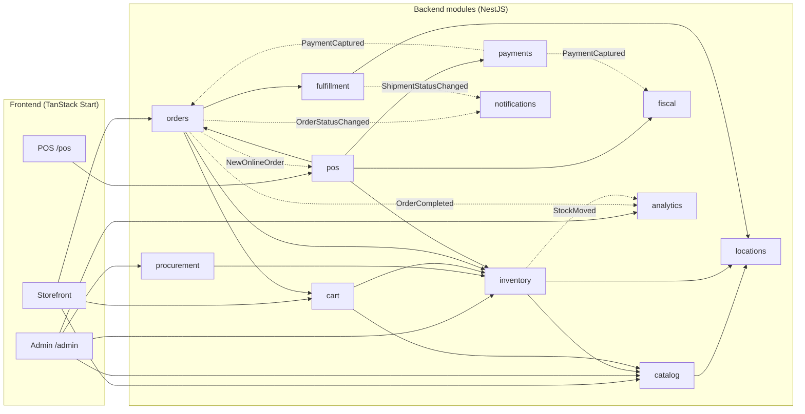

# Roadmap & Feature Map

Single source of truth for modules, epics and features of the Omnichannel Flower Network.
Architecture details live in [init.md](init.md).

## How this file maps to the issue tracker

| Level | In this file | In GitHub |
|---|---|---|
| Stage | `S1`…`S4` | Milestone `Stage 1`…`Stage 4` |
| Module | `INV`, `ORD`, … | Label `module:inventory`, `module:orders`, … |
| Epic | `E_INV_S2` (module × stage) | Parent issue with sub-issues |
| Feature | `INV-01` | Sub-issue; title starts with the feature ID, e.g. `INV-01: Stock ledger core` |

Feature IDs are permanent. Never reuse or renumber an ID; mark dropped features as `dropped` instead.

Status values: `todo` · `wip` · `done` · `blocked`. The `%% status` blocks in the diagrams below are meant to be regenerated automatically from issue states.

---

## 1. Module map

Solid arrow — synchronous call through the module's public service.
Dashed arrow — asynchronous event through the Transactional Outbox.
`identity` and `platform` are used by every module and are omitted for readability.

---

## 2. Epics by stage

Each node is an epic (one parent issue). Colour reflects the epic status.

```mermaid
flowchart TB
  subgraph S1["Stage 1 · Infrastructure & Core"]
    E_PLT_S1["PLT · Platform"]
    E_IAM_S1["IAM · Auth & roles"]
  end

  subgraph S2["Stage 2 · Catalog, Inventory, Procurement"]
    E_LOC_S2["LOC · Locations"]
    E_CAT_S2["CAT · Catalog & bouquets"]
    E_PRC_S2["PRC · Procurement"]
    E_INV_S2["INV · Inventory"]
    E_ADM_S2["ADM · Admin UI"]
  end

  subgraph S3["Stage 3 · Storefront, Checkout, Payments, Delivery"]
    E_STF_S3["STF · Storefront"]
    E_CRT_S3["CRT · Cart"]
    E_ORD_S3["ORD · Orders & reservations"]
    E_PAY_S3["PAY · Payments"]
    E_FUL_S3["FUL · Fulfillment"]
    E_NTF_S3["NTF · Notifications"]
    E_IAM_S3["IAM · Customers"]
    E_INV_S3["INV · Availability"]
  end

  subgraph S4["Stage 4 · POS, Analytics, Hardening"]
    E_POS_S4["POS · Point of sale"]
    E_FSC_S4["FSC · Fiscal"]
    E_ORD_S4["ORD · Returns"]
    E_PAY_S4["PAY · Refunds"]
    E_ANL_S4["ANL · Analytics"]
    E_INV_S4["INV · Reconciliation"]
    E_PLT_S4["PLT · Load tests & deploy"]
  end

  S1 --> S2 --> S3 --> S4

  classDef todo fill:#e5e7eb,stroke:#6b7280,color:#111827
  classDef wip fill:#fde68a,stroke:#b45309,color:#111827
  classDef done fill:#bbf7d0,stroke:#15803d,color:#111827
  classDef blocked fill:#fecaca,stroke:#b91c1c,color:#111827

  %% status:start
  class E_PLT_S1,E_IAM_S1,E_LOC_S2,E_CAT_S2,E_PRC_S2,E_INV_S2,E_ADM_S2,E_STF_S3,E_CRT_S3,E_ORD_S3,E_PAY_S3,E_FUL_S3,E_NTF_S3,E_IAM_S3,E_INV_S3,E_POS_S4,E_FSC_S4,E_ORD_S4,E_PAY_S4,E_ANL_S4,E_INV_S4,E_PLT_S4 todo
  %% status:end
```

---

## 3. Feature registry

The `Issue` column is filled in once the issue is created.

### Stage 1 · Infrastructure & Core

| ID | Epic | Feature | Depends on | Status | Issue |
|---|---|---|---|---|---|
| PLT-01 | E_PLT_S1 | `docker-compose`: PostgreSQL 17, Redis, MinIO, Prometheus, Grafana | — | todo | |
| PLT-02 | E_PLT_S1 | Monorepo: NestJS app, TanStack Start app, shared types package | — | todo | |
| PLT-03 | E_PLT_S1 | ADR-1: choose ORM; migrations pipeline | PLT-02 | todo | |
| PLT-04 | E_PLT_S1 | Transactional Outbox, relay worker (BullMQ), `processed_events` | PLT-03 | todo | |
| PLT-05 | E_PLT_S1 | Structured logging (`pino`), OpenTelemetry tracing, metrics endpoint | PLT-02 | todo | |
| PLT-06 | E_PLT_S1 | OpenAPI generation and typed frontend client | PLT-02 | todo | |
| PLT-07 | E_PLT_S1 | CI: lint, typecheck, tests, migration check | PLT-02 | todo | |
| PLT-08 | E_PLT_S1 | Seed data generator (locations, catalog, stock at volume) | PLT-03 | todo | |
| IAM-01 | E_IAM_S1 | Staff users, authentication, sessions in Redis | PLT-03 | todo | |
| IAM-02 | E_IAM_S1 | Roles & permissions (owner, admin, florist, courier), `staff_locations` | IAM-01 | todo | |

### Stage 2 · Catalog, Inventory, Procurement

| ID | Epic | Feature | Depends on | Status | Issue |
|---|---|---|---|---|---|
| LOC-01 | E_LOC_S2 | Locations: stores & warehouses, coordinates, opening hours | PLT-03 | todo | |
| CAT-01 | E_CAT_S2 | Products & variants (master variant) | PLT-03 | todo | |
| CAT-02 | E_CAT_S2 | Taxon tree (materialized path / nested sets) | CAT-01 | todo | |
| CAT-03 | E_CAT_S2 | Option types / attributes | CAT-01 | todo | |
| CAT-04 | E_CAT_S2 | Prices (UAH, kopecks) | CAT-01 | todo | |
| CAT-05 | E_CAT_S2 | Media upload to MinIO | CAT-01, PLT-01 | todo | |
| CAT-06 | E_CAT_S2 | Bouquet composition (`variant_components`, `kit_type`) | CAT-01 | todo | |
| PRC-01 | E_PRC_S2 | Suppliers | PLT-03 | todo | |
| PRC-02 | E_PRC_S2 | Goods receipts with unit cost → `receipt` movement + batch | PRC-01, INV-01, INV-02 | todo | |
| INV-01 | E_INV_S2 | Stock ledger core: `location_stocks` + `stock_movements` in one transaction | LOC-01, CAT-01, PLT-04 | todo | |
| INV-02 | E_INV_S2 | Stock batches with FIFO consumption | INV-01 | todo | |
| INV-03 | E_INV_S2 | Write-offs with reasons, linked to batches | INV-02 | todo | |
| INV-04 | E_INV_S2 | Stock transfers: `draft → shipped → received → closed`, in-transit, losses | INV-01 | todo | |
| INV-05 | E_INV_S2 | Inventory counts and `count_adjustment` | INV-01 | todo | |
| INV-06 | E_INV_S2 | Bouquet assembly (`assembly_consume` / `assembly_produce`) | INV-02, CAT-06 | todo | |
| ADM-01 | E_ADM_S2 | Admin shell: layout, login, role-based navigation | IAM-02 | todo | |
| ADM-02 | E_ADM_S2 | Catalog management screens | ADM-01, CAT-01…CAT-06 | todo | |
| ADM-03 | E_ADM_S2 | Inventory & procurement screens (receipts, transfers, counts, write-offs) | ADM-01, INV-01…INV-06, PRC-02 | todo | |

### Stage 3 · Storefront, Checkout, Payments, Delivery

| ID | Epic | Feature | Depends on | Status | Issue |
|---|---|---|---|---|---|
| INV-07 | E_INV_S3 | Availability per location API (incl. computed `made_to_order` availability) | INV-01, CAT-06 | todo | |
| STF-01 | E_STF_S3 | Catalog pages: SSR, slugs, sitemap, typed search params | CAT-01…CAT-05, PLT-06 | todo | |
| STF-02 | E_STF_S3 | Filter by availability in a selected store | STF-01, INV-07 | todo | |
| STF-03 | E_STF_S3 | Checkout UI: pickup / delivery, recipient, card message, slot | CRT-01, FUL-01…FUL-04 | todo | |
| CRT-01 | E_CRT_S3 | Redis cart with TTL; price & stock re-check at checkout | CAT-04, INV-07 | todo | |
| ORD-01 | E_ORD_S3 | Order model: items snapshot (incl. cost), adjustments | CRT-01 | todo | |
| ORD-02 | E_ORD_S3 | State machines: `state`, `payment_state`, `shipment_state` | ORD-01 | todo | |
| ORD-03 | E_ORD_S3 | Stock reservations: 15 min online / pickup window, BullMQ expiry, `pickup_expired` | ORD-02, INV-01 | todo | |
| PAY-01 | E_PAY_S3 | Payments model and `PaymentProvider` interface | ORD-01 | todo | |
| PAY-02 | E_PAY_S3 | ADR-4: provider integration, idempotent webhooks (`payment_events`) | PAY-01, PLT-04 | todo | |
| FUL-01 | E_FUL_S3 | Shipments: pickup / courier, single fulfilling location (ADR-2) | ORD-01, LOC-01 | todo | |
| FUL-02 | E_FUL_S3 | Delivery zones & pricing (ADR-8) | FUL-01 | todo | |
| FUL-03 | E_FUL_S3 | Delivery time slots with capacity | FUL-01 | todo | |
| FUL-04 | E_FUL_S3 | Recipient fields, card message, anonymous delivery | FUL-01 | todo | |
| NTF-01 | E_NTF_S3 | ADR-5: `NotificationChannel` interface, templates | PLT-04 | todo | |
| NTF-02 | E_NTF_S3 | Order & shipment status triggers | NTF-01, ORD-02 | todo | |
| IAM-03 | E_IAM_S3 | ADR-3: guest checkout by phone, optional customer account | IAM-01 | todo | |

### Stage 4 · POS, Analytics, Hardening

| ID | Epic | Feature | Depends on | Status | Issue |
|---|---|---|---|---|---|
| POS-01 | E_POS_S4 | POS quick sale (orders channel `pos`) | ORD-02, IAM-02 | todo | |
| POS-02 | E_POS_S4 | Cash shifts and cash operations | POS-01 | todo | |
| POS-03 | E_POS_S4 | Real-time online order feed (WebSocket / SSE) and assembling workflow | ORD-02, PLT-04 | todo | |
| POS-04 | E_POS_S4 | Custom bouquet at POS (components consumed from stock) | POS-01, INV-06 | todo | |
| POS-05 | E_POS_S4 | Pickup handover with pay-on-pickup | POS-01, ORD-03 | todo | |
| FSC-01 | E_FSC_S4 | `FiscalProvider` interface + stub implementation | PAY-01 | todo | |
| ORD-04 | E_ORD_S4 | Returns: restock or write-off | ORD-02, INV-03 | todo | |
| PAY-03 | E_PAY_S4 | Refunds | PAY-02, ORD-04 | todo | |
| ANL-01 | E_ANL_S4 | Materialized views + concurrent refresh cron | ORD-02, INV-03 | todo | |
| ANL-02 | E_ANL_S4 | Rollup table via outbox, idempotent increments | PLT-04, ORD-02 | todo | |
| ANL-03 | E_ANL_S4 | Owner dashboard: sales, margin, waste in UAH | ANL-01, ANL-02 | todo | |
| INV-08 | E_INV_S4 | Nightly ledger reconciliation job | INV-01 | todo | |
| PLT-09 | E_PLT_S4 | k6 load tests incl. concurrent POS + online sale of the last item | POS-01, ORD-03 | todo | |
| PLT-10 | E_PLT_S4 | ADR-7: deployment target, PostgreSQL backups | — | todo | |
