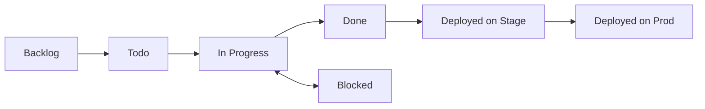
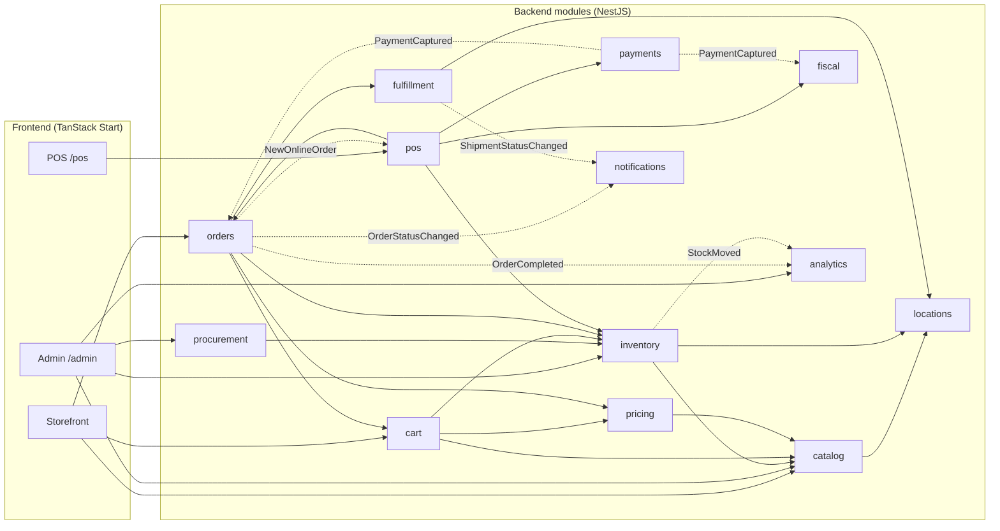

# Roadmap & Feature Map

Single source of truth for modules, epics and features of the Omnichannel Flower Network.
Architecture details live in [init.md](init.md).

## How this file maps to the issue tracker

| Level | In this file | In GitHub |
|---|---|---|
| Stage | `S1`…`S4` | Milestone `Stage 1`…`Stage 4` |
| Module | `INV`, `ORD`, … | Label `module:inventory`, `module:orders`, … |
| Epic | `E_INV_S2` (module × stage) | Parent issue with sub-issues |
| Feature | `INV-01` | Sub-issue; title starts with the feature ID, e.g. `INV-01: Stock ledger core` |

Feature IDs are permanent. Never reuse or renumber an ID; mark dropped features as `dropped` instead.

The live status of every issue is the `Status` field on the [Project board](https://github.com/users/DevAgassi/projects/1). The `Status` column of the feature registry below only records `todo`, `done` or `dropped` and is updated in the pull request that finishes the feature. The `%% status` blocks in the diagrams are meant to be regenerated automatically from issue states.

## Board workflow

| Column | Meaning | How an issue gets here |
|---|---|---|
| **Backlog** | Not ready: details or decisions are missing, or the issue is still being written | Default for new issues |
| **Todo** | Ready to start: scope and acceptance are clear | Moved manually after refinement |
| **In Progress** | Being worked on | Moved manually when work starts |
| **Blocked** | Started, but stopped by a problem | Moved manually; a comment on the issue says what blocks it and what unblocks it. Returns to In Progress when resolved |
| **Done** | Merged to `main` | Automatically, when the PR with `Closes #N` is merged |
| **Deployed on Stage** | Running on the staging environment | Not used yet — enabled together with deployment (PLT-10) |
| **Deployed on Prod** | Running in production | Not used yet — enabled together with deployment (PLT-10) |

---

## 1. Module map

Solid arrow — synchronous call through the module's public service.
Dashed arrow — asynchronous event through the Transactional Outbox.
`identity` and `platform` are used by every module and are omitted for readability.

---

## 2. Epics by stage

Each node is an epic (one parent issue). Colour reflects the epic status.

```mermaid
flowchart TB
  subgraph S1["Stage 1 · Infrastructure & Core"]
    E_PLT_S1["PLT · Platform"]
    E_IAM_S1["IAM · Auth & roles"]
  end

  subgraph S2["Stage 2 · Catalog, Inventory, Procurement"]
    E_LOC_S2["LOC · Locations"]
    E_CAT_S2["CAT · Catalog & bouquets"]
    E_PRC_S2["PRC · Procurement"]
    E_INV_S2["INV · Inventory"]
    E_ADM_S2["ADM · Admin UI"]
  end

  subgraph S3["Stage 3 · Storefront, Checkout, Payments, Delivery"]
    E_STF_S3["STF · Storefront"]
    E_CRT_S3["CRT · Cart"]
    E_ORD_S3["ORD · Orders & reservations"]
    E_PAY_S3["PAY · Payments"]
    E_FUL_S3["FUL · Fulfillment"]
    E_NTF_S3["NTF · Notifications"]
    E_IAM_S3["IAM · Customers"]
    E_INV_S3["INV · Availability"]
    E_PRI_S3["PRI · Pricing & promotions"]
  end

  subgraph S4["Stage 4 · POS, Analytics, Hardening"]
    E_POS_S4["POS · Point of sale"]
    E_FSC_S4["FSC · Fiscal"]
    E_ORD_S4["ORD · Returns"]
    E_PAY_S4["PAY · Refunds"]
    E_ANL_S4["ANL · Analytics"]
    E_INV_S4["INV · Reconciliation"]
    E_PLT_S4["PLT · Load tests & deploy"]
  end

  S1 --> S2 --> S3 --> S4

  classDef todo fill:#e5e7eb,stroke:#6b7280,color:#111827
  classDef wip fill:#fde68a,stroke:#b45309,color:#111827
  classDef done fill:#bbf7d0,stroke:#15803d,color:#111827
  classDef blocked fill:#fecaca,stroke:#b91c1c,color:#111827

  %% status:start
  class E_PLT_S1,E_IAM_S1,E_LOC_S2,E_CAT_S2,E_PRC_S2,E_INV_S2,E_ADM_S2,E_STF_S3,E_CRT_S3,E_ORD_S3,E_PAY_S3,E_FUL_S3,E_NTF_S3,E_IAM_S3,E_INV_S3,E_PRI_S3,E_POS_S4,E_FSC_S4,E_ORD_S4,E_PAY_S4,E_ANL_S4,E_INV_S4,E_PLT_S4 todo
  %% status:end
```

### Epic issues

<!-- epics:start -->
| Epic | Title | Issue |
|---|---|---|
| E_PLT_S1 | Platform | [#1](https://github.com/DevAgassi/flower-network/issues/1) |
| E_IAM_S1 | Auth & roles | [#2](https://github.com/DevAgassi/flower-network/issues/2) |
| E_LOC_S2 | Locations | [#3](https://github.com/DevAgassi/flower-network/issues/3) |
| E_CAT_S2 | Catalog & bouquets | [#4](https://github.com/DevAgassi/flower-network/issues/4) |
| E_PRC_S2 | Procurement | [#5](https://github.com/DevAgassi/flower-network/issues/5) |
| E_INV_S2 | Inventory | [#6](https://github.com/DevAgassi/flower-network/issues/6) |
| E_ADM_S2 | Admin UI | [#7](https://github.com/DevAgassi/flower-network/issues/7) |
| E_STF_S3 | Storefront | [#8](https://github.com/DevAgassi/flower-network/issues/8) |
| E_CRT_S3 | Cart | [#9](https://github.com/DevAgassi/flower-network/issues/9) |
| E_ORD_S3 | Orders & reservations | [#10](https://github.com/DevAgassi/flower-network/issues/10) |
| E_PAY_S3 | Payments | [#11](https://github.com/DevAgassi/flower-network/issues/11) |
| E_FUL_S3 | Fulfillment | [#12](https://github.com/DevAgassi/flower-network/issues/12) |
| E_NTF_S3 | Notifications | [#13](https://github.com/DevAgassi/flower-network/issues/13) |
| E_IAM_S3 | Customers | [#14](https://github.com/DevAgassi/flower-network/issues/14) |
| E_INV_S3 | Availability | [#15](https://github.com/DevAgassi/flower-network/issues/15) |
| E_PRI_S3 | Pricing & promotions | [#82](https://github.com/DevAgassi/flower-network/issues/82) |
| E_POS_S4 | Point of sale | [#16](https://github.com/DevAgassi/flower-network/issues/16) |
| E_FSC_S4 | Fiscal | [#17](https://github.com/DevAgassi/flower-network/issues/17) |
| E_ORD_S4 | Returns | [#18](https://github.com/DevAgassi/flower-network/issues/18) |
| E_PAY_S4 | Refunds | [#19](https://github.com/DevAgassi/flower-network/issues/19) |
| E_ANL_S4 | Analytics | [#20](https://github.com/DevAgassi/flower-network/issues/20) |
| E_INV_S4 | Reconciliation | [#21](https://github.com/DevAgassi/flower-network/issues/21) |
| E_PLT_S4 | Load tests & deploy | [#22](https://github.com/DevAgassi/flower-network/issues/22) |
<!-- epics:end -->

---

## 3. Feature registry

The `Issue` column is filled in once the issue is created.

### Stage 1 · Infrastructure & Core

| ID | Epic | Feature | Depends on | Status | Issue |
|---|---|---|---|---|---|
| PLT-01 | E_PLT_S1 | `docker-compose`: PostgreSQL 17, pgAdmin, Redis, RustFS (S3), Prometheus, Grafana | — | done | [#23](https://github.com/DevAgassi/flower-network/issues/23) |
| PLT-02 | E_PLT_S1 | Monorepo: NestJS app, TanStack Start app, shared types package | — | done | [#24](https://github.com/DevAgassi/flower-network/issues/24) |
| PLT-03 | E_PLT_S1 | Drizzle (ADR-1): `DatabaseModule`, drizzle-kit migrations pipeline | PLT-02 | done | [#25](https://github.com/DevAgassi/flower-network/issues/25) |
| PLT-04 | E_PLT_S1 | Transactional outbox (@nestjs/outbox): PostgreSQL store, worker process, inbox | PLT-03 | done | [#26](https://github.com/DevAgassi/flower-network/issues/26) |
| PLT-05 | E_PLT_S1 | Structured logging (`pino`), OpenTelemetry tracing, metrics endpoint | PLT-02 | todo | [#27](https://github.com/DevAgassi/flower-network/issues/27) |
| PLT-06 | E_PLT_S1 | OpenAPI generation and typed frontend client | PLT-02 | todo | [#28](https://github.com/DevAgassi/flower-network/issues/28) |
| PLT-07 | E_PLT_S1 | CI: lint, typecheck, tests, migration check | PLT-02 | todo | [#29](https://github.com/DevAgassi/flower-network/issues/29) |
| PLT-08 | E_PLT_S1 | Seed data generator (locations, catalog, stock at volume) | PLT-03 | todo | [#30](https://github.com/DevAgassi/flower-network/issues/30) |
| PLT-11 | E_PLT_S1 | Environment configuration: zod-validated env, development / production modes, `pnpm start` | PLT-02 | done | [#91](https://github.com/DevAgassi/flower-network/issues/91) |
| IAM-01 | E_IAM_S1 | Staff users, authentication, sessions in Redis | PLT-03 | todo | [#31](https://github.com/DevAgassi/flower-network/issues/31) |
| IAM-02 | E_IAM_S1 | Roles & permissions (owner, admin, florist, courier), `staff_locations` | IAM-01 | todo | [#32](https://github.com/DevAgassi/flower-network/issues/32) |

### Stage 2 · Catalog, Inventory, Procurement

| ID | Epic | Feature | Depends on | Status | Issue |
|---|---|---|---|---|---|
| LOC-01 | E_LOC_S2 | Locations: stores & warehouses, coordinates, opening hours | PLT-03 | todo | [#33](https://github.com/DevAgassi/flower-network/issues/33) |
| CAT-01 | E_CAT_S2 | Products & variants (master variant) | PLT-03 | todo | [#34](https://github.com/DevAgassi/flower-network/issues/34) |
| CAT-02 | E_CAT_S2 | Taxonomies (multiple trees: category, occasion) and taxons on `ltree` | CAT-01 | todo | [#35](https://github.com/DevAgassi/flower-network/issues/35) |
| CAT-03 | E_CAT_S2 | Option types / attributes | CAT-01 | todo | [#36](https://github.com/DevAgassi/flower-network/issues/36) |
| CAT-04 | E_CAT_S2 | Prices (UAH, kopecks) | CAT-01 | todo | [#37](https://github.com/DevAgassi/flower-network/issues/37) |
| CAT-05 | E_CAT_S2 | Media upload to S3 storage | CAT-01, PLT-01 | todo | [#38](https://github.com/DevAgassi/flower-network/issues/38) |
| CAT-06 | E_CAT_S2 | Bouquet composition (`variant_components`, `kit_type`) | CAT-01 | todo | [#39](https://github.com/DevAgassi/flower-network/issues/39) |
| PRC-01 | E_PRC_S2 | Suppliers | PLT-03 | todo | [#40](https://github.com/DevAgassi/flower-network/issues/40) |
| PRC-02 | E_PRC_S2 | Goods receipts with unit cost → `receipt` movement + batch | PRC-01, INV-01, INV-02 | todo | [#43](https://github.com/DevAgassi/flower-network/issues/43) |
| INV-01 | E_INV_S2 | Stock ledger core: `location_stocks` + `stock_movements` in one transaction | LOC-01, CAT-01, PLT-04 | todo | [#41](https://github.com/DevAgassi/flower-network/issues/41) |
| INV-02 | E_INV_S2 | Stock batches with FIFO consumption | INV-01 | todo | [#42](https://github.com/DevAgassi/flower-network/issues/42) |
| INV-03 | E_INV_S2 | Write-offs with reasons, linked to batches | INV-02 | todo | [#44](https://github.com/DevAgassi/flower-network/issues/44) |
| INV-04 | E_INV_S2 | Stock transfers: `draft → shipped → received → closed`, in-transit, losses | INV-01 | todo | [#45](https://github.com/DevAgassi/flower-network/issues/45) |
| INV-05 | E_INV_S2 | Inventory counts and `count_adjustment` | INV-01 | todo | [#46](https://github.com/DevAgassi/flower-network/issues/46) |
| INV-06 | E_INV_S2 | Bouquet assembly (`assembly_consume` / `assembly_produce`) | INV-02, CAT-06 | todo | [#47](https://github.com/DevAgassi/flower-network/issues/47) |
| ADM-01 | E_ADM_S2 | Admin shell: layout, login, role-based navigation | IAM-02 | todo | [#48](https://github.com/DevAgassi/flower-network/issues/48) |
| ADM-02 | E_ADM_S2 | Catalog management screens | ADM-01, CAT-01…CAT-06 | todo | [#49](https://github.com/DevAgassi/flower-network/issues/49) |
| ADM-03 | E_ADM_S2 | Inventory & procurement screens (receipts, transfers, counts, write-offs) | ADM-01, INV-01…INV-06, PRC-02 | todo | [#50](https://github.com/DevAgassi/flower-network/issues/50) |

### Stage 3 · Storefront, Checkout, Payments, Delivery

| ID | Epic | Feature | Depends on | Status | Issue |
|---|---|---|---|---|---|
| INV-07 | E_INV_S3 | Availability per location API (incl. computed `made_to_order` availability) | INV-01, CAT-06 | todo | [#51](https://github.com/DevAgassi/flower-network/issues/51) |
| STF-01 | E_STF_S3 | Catalog pages: SSR, slugs, sitemap, typed search params | CAT-01…CAT-05, PLT-06 | todo | [#52](https://github.com/DevAgassi/flower-network/issues/52) |
| STF-02 | E_STF_S3 | Filter by availability in a selected store | STF-01, INV-07 | todo | [#53](https://github.com/DevAgassi/flower-network/issues/53) |
| STF-03 | E_STF_S3 | Checkout UI: pickup / delivery, recipient, card message, slot | CRT-01, FUL-01…FUL-04 | todo | [#60](https://github.com/DevAgassi/flower-network/issues/60) |
| PRI-01 | E_PRI_S3 | Shared `PriceCalculator`: line totals, adjustments, delivery cost | CAT-04 | todo | [#83](https://github.com/DevAgassi/flower-network/issues/83) |
| PRI-02 | E_PRI_S3 | Promo codes: promotions, rules, actions, coupon codes | PRI-01 | todo | [#84](https://github.com/DevAgassi/flower-network/issues/84) |
| CRT-01 | E_CRT_S3 | Cart module: PostgreSQL `carts` / `cart_items` behind `CartRepository`, expiry cleanup, re-check at checkout (ADR-9) | CAT-04, INV-07, PRI-01 | todo | [#54](https://github.com/DevAgassi/flower-network/issues/54) |
| ORD-01 | E_ORD_S3 | Order model: `number`, `token`, items snapshot (incl. cost), adjustments by level & source | CRT-01 | todo | [#55](https://github.com/DevAgassi/flower-network/issues/55) |
| ORD-05 | E_ORD_S3 | State change history (`state_changes`) for orders, payments, shipments | ORD-02 | todo | [#85](https://github.com/DevAgassi/flower-network/issues/85) |
| ORD-06 | E_ORD_S3 | Denormalized order totals recalculated only by `OrderUpdater` | ORD-01, PRI-01 | todo | [#86](https://github.com/DevAgassi/flower-network/issues/86) |
| ORD-02 | E_ORD_S3 | State machines: `state`, `payment_state`, `shipment_state` | ORD-01 | todo | [#61](https://github.com/DevAgassi/flower-network/issues/61) |
| ORD-03 | E_ORD_S3 | Stock reservations: 15 min online / pickup window, BullMQ expiry, `pickup_expired` | ORD-02, INV-01 | todo | [#62](https://github.com/DevAgassi/flower-network/issues/62) |
| PAY-01 | E_PAY_S3 | Payments model and `PaymentProvider` interface | ORD-01 | todo | [#63](https://github.com/DevAgassi/flower-network/issues/63) |
| PAY-02 | E_PAY_S3 | ADR-4: provider integration, idempotent webhooks (`payment_events`) | PAY-01, PLT-04 | todo | [#64](https://github.com/DevAgassi/flower-network/issues/64) |
| FUL-01 | E_FUL_S3 | Shipments: pickup / courier, single fulfilling location (ADR-2) | ORD-01, LOC-01 | todo | [#56](https://github.com/DevAgassi/flower-network/issues/56) |
| FUL-02 | E_FUL_S3 | Delivery zones & pricing (ADR-8), `shipping_rates` with selected rate | FUL-01 | todo | [#57](https://github.com/DevAgassi/flower-network/issues/57) |
| FUL-03 | E_FUL_S3 | Delivery time slots with capacity | FUL-01 | todo | [#58](https://github.com/DevAgassi/flower-network/issues/58) |
| FUL-04 | E_FUL_S3 | Recipient fields, card message, anonymous delivery | FUL-01 | todo | [#59](https://github.com/DevAgassi/flower-network/issues/59) |
| NTF-01 | E_NTF_S3 | ADR-5: `NotificationChannel` interface, templates | PLT-04 | todo | [#65](https://github.com/DevAgassi/flower-network/issues/65) |
| NTF-02 | E_NTF_S3 | Order & shipment status triggers | NTF-01, ORD-02 | todo | [#66](https://github.com/DevAgassi/flower-network/issues/66) |
| IAM-03 | E_IAM_S3 | ADR-3: guest checkout by phone, optional customer account | IAM-01 | todo | [#67](https://github.com/DevAgassi/flower-network/issues/67) |

### Stage 4 · POS, Analytics, Hardening

| ID | Epic | Feature | Depends on | Status | Issue |
|---|---|---|---|---|---|
| POS-01 | E_POS_S4 | POS quick sale (orders channel `pos`) | ORD-02, IAM-02 | todo | [#68](https://github.com/DevAgassi/flower-network/issues/68) |
| POS-02 | E_POS_S4 | Cash shifts and cash operations | POS-01 | todo | [#69](https://github.com/DevAgassi/flower-network/issues/69) |
| POS-03 | E_POS_S4 | Real-time online order feed (WebSocket / SSE) and assembling workflow | ORD-02, PLT-04 | todo | [#70](https://github.com/DevAgassi/flower-network/issues/70) |
| POS-04 | E_POS_S4 | Custom bouquet at POS (components consumed from stock) | POS-01, INV-06 | todo | [#71](https://github.com/DevAgassi/flower-network/issues/71) |
| POS-05 | E_POS_S4 | Pickup handover with pay-on-pickup | POS-01, ORD-03 | todo | [#72](https://github.com/DevAgassi/flower-network/issues/72) |
| FSC-01 | E_FSC_S4 | `FiscalProvider` interface + stub implementation | PAY-01 | todo | [#73](https://github.com/DevAgassi/flower-network/issues/73) |
| ORD-04 | E_ORD_S4 | Returns: authorizations, return items, reasons; restock or write-off | ORD-02, INV-03 | todo | [#74](https://github.com/DevAgassi/flower-network/issues/74) |
| PAY-03 | E_PAY_S4 | Refunds | PAY-02, ORD-04 | todo | [#75](https://github.com/DevAgassi/flower-network/issues/75) |
| ANL-01 | E_ANL_S4 | Materialized views + concurrent refresh cron | ORD-02, INV-03 | todo | [#76](https://github.com/DevAgassi/flower-network/issues/76) |
| ANL-02 | E_ANL_S4 | Rollup table via outbox, idempotent increments | PLT-04, ORD-02 | todo | [#77](https://github.com/DevAgassi/flower-network/issues/77) |
| ANL-03 | E_ANL_S4 | Owner dashboard: sales, margin, waste in UAH | ANL-01, ANL-02 | todo | [#78](https://github.com/DevAgassi/flower-network/issues/78) |
| INV-08 | E_INV_S4 | Nightly ledger reconciliation job | INV-01 | todo | [#79](https://github.com/DevAgassi/flower-network/issues/79) |
| PLT-09 | E_PLT_S4 | k6 load tests incl. concurrent POS + online sale of the last item; cart storage benchmark (PostgreSQL vs Redis) | POS-01, ORD-03 | todo | [#80](https://github.com/DevAgassi/flower-network/issues/80) |
| PLT-10 | E_PLT_S4 | ADR-7: deployment target, PostgreSQL backups | — | todo | [#81](https://github.com/DevAgassi/flower-network/issues/81) |
