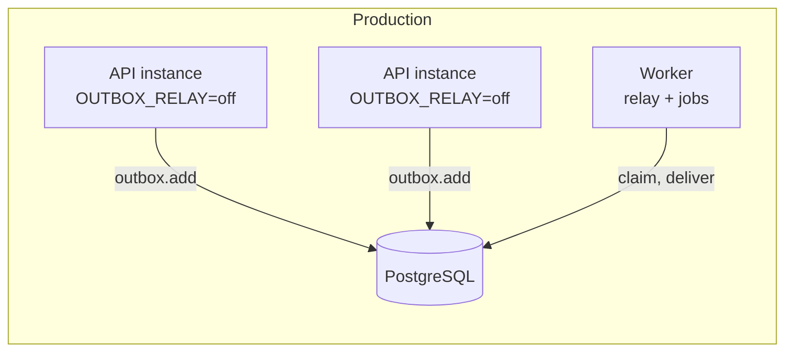

# API and worker (`apps/api`)

One NestJS 12 application with two entry points over the same modules ([`AppModule`](../../apps/api/src/app.module.ts)):

| Process | Entry point                                     | What it runs                                                                         | Development                            | Production                            |
| ------- | ----------------------------------------------- | ------------------------------------------------------------------------------------ | -------------------------------------- | ------------------------------------- |
| API     | [`src/main.ts`](../../apps/api/src/main.ts)     | HTTP server on `PORT` (3001), including `/metrics`                                   | `pnpm dev`; also runs the outbox relay | `start`, with `OUTBOX_RELAY=off`      |
| Worker  | [`src/worker.ts`](../../apps/api/src/worker.ts) | Outbox relay, its handlers, scheduled jobs; only `/metrics` on `METRICS_PORT` (9464) | not needed (`dev:worker` to test it)   | `start:worker`, one or more instances |

Each entry point first calls `startTracing()` and then imports the process code from `src/processes/` dynamically, so OpenTelemetry can patch libraries as they load ([Observability](../modules/platform/observability.md)).

The worker refuses to start with `OUTBOX_RELAY=off` — it would do nothing. A separate package for the worker is created only when it gets code the API does not have (ADR-10).



## Source layout

```
src/
  main.ts                 HTTP entry point: starts tracing, then imports processes/api.ts
  worker.ts               worker entry point: starts tracing, then imports processes/worker.ts
  processes/              what each process does once started
  bootstrap.ts            startup log levels, runOrExit()
  migrate-outbox.ts       outbox schema migration (part of db:migrate)
  app.module.ts           root module: config, database, schedule, outbox, health, business modules
  config/                 environment schema and AppConfigModule
  database/               DatabaseModule, schema registry
  outbox/                 AppOutboxModule, inbox retention
  observability/          tracing (OpenTelemetry), logging (pino), metrics (Prometheus)
  health/                 GET /health
  <module>/               business modules (from Stage 2)
test/                     e2e tests against the real database
drizzle/                  SQL migrations
```

## Health check

`GET /health` returns `200` when every check is up and `503` with the same body otherwise, so load balancers and orchestrators can react. The response type `HealthResponse` is shared through `@flower/shared`.

```json
{
  "status": "ok",
  "service": "api",
  "timestamp": "2026-11-15T12:00:00.000Z",
  "checks": { "database": "up", "outbox": "up" }
}
```

| Check      | How                                     |
| ---------- | --------------------------------------- |
| `database` | `select 1`                              |
| `outbox`   | `relay.stats()` reads the outbox tables |

## Startup and shutdown

- Configuration is validated before anything else starts ([Configuration](../modules/platform/configuration.md)).
- Until the app is created, Nest's own logger prints startup lines; then pino takes over (`bufferLogs` replays the buffered lines through pino).
- `enableShutdownHooks()`: on `SIGTERM` the HTTP server stops, the relay stops claiming, finishes in-flight deliveries and releases its leases, buffered spans are sent, then the database pool closes.

## Scripts

| Script (`pnpm --filter @flower/api …`)               | What it does                                    |
| ---------------------------------------------------- | ----------------------------------------------- |
| `dev` / `dev:worker`                                 | Watch mode for the API / the worker             |
| `start` / `start:worker`                             | Built output with `NODE_ENV=production`         |
| `test`                                               | Unit tests (`*.spec.ts` next to the code)       |
| `test:e2e`                                           | E2E tests in `test/` — needs `pnpm infra:up`    |
| `lint` / `typecheck`                                 | oxlint (type-aware) / tsc                       |
| `db:generate`, `db:migrate`, `db:check`, `db:studio` | See [Database](../modules/platform/database.md) |

## Testing

- **Unit** (`src/**/*.spec.ts`): Vitest with globals; mocks with `vi.fn()`.
- **E2E** (`test/*.e2e-spec.ts`): the real PostgreSQL from `compose.yaml`. Tests that create tables work in a throwaway schema and drop it in `afterAll`, so they never touch development data.
