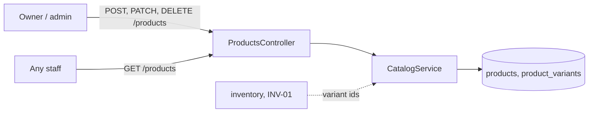

# Catalog

What the network sells. **Products** are what a customer sees as one item ("Ecuador rose"); **variants** are the concrete sellable forms with their own SKU ("Ecuador rose, 60 cm"). Stock, prices, carts and orders work only with variants. Categories, options, prices, photos and bouquet recipes join this module in CAT-02…CAT-06.

Roadmap: CAT-01 ([#34](https://github.com/DevAgassi/flower-network/issues/34)), CAT-02…CAT-06 in [ROADMAP.md](../../../ROADMAP.md) · Spec: [init.md §4.2](../../../init.md)

## Pieces

| Piece                                | Code                                                                                                                                                         | Reference                                           |
| ------------------------------------ | ------------------------------------------------------------------------------------------------------------------------------------------------------------ | --------------------------------------------------- |
| `products`, `product_variants`       | [`catalog.schema.ts`](../../../apps/api/src/catalog/catalog.schema.ts)                                                                                       | [Products and variants](products.md#data)           |
| `/products` endpoints                | [`products.controller.ts`](../../../apps/api/src/catalog/products.controller.ts), [`catalog.contract.ts`](../../../apps/api/src/catalog/catalog.contract.ts) | [Products and variants](products.md#api)            |
| `CatalogService`, `sellableVariants` | [`catalog.service.ts`](../../../apps/api/src/catalog/catalog.service.ts)                                                                                     | [Products and variants](products.md#master-variant) |

## How it fits together

- Data: `products` and `product_variants`. Only this module reads or writes them; other modules call `CatalogService` (methods are added with their first consumer).
- Events: none yet.

## Guides

None yet — catalog screens arrive with ADM-02.

## Journal

Problems and their solutions: [journal.md](journal.md).
