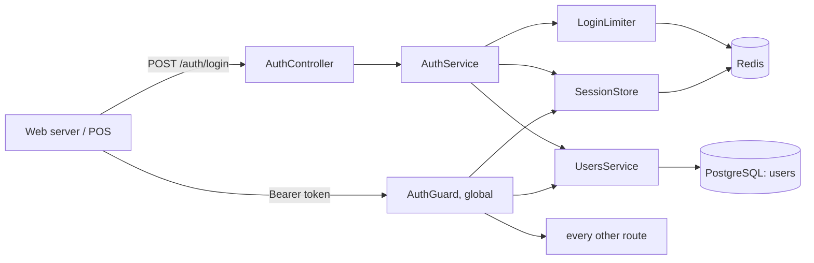

# Identity

Who is signed in. Staff users (owner, admins, florists, couriers), their passwords and sessions, and the guard that protects every API route. Roles and shop bindings come next (IAM-02); customer accounts later (IAM-03).

Roadmap: IAM-01 ([#31](https://github.com/DevAgassi/flower-network/issues/31)), IAM-02, IAM-03 in [ROADMAP.md](../../../ROADMAP.md) · Spec: [init.md §4.8](../../../init.md)

## Pieces

| Piece                                | Code                                                                                                                                                     | Reference                                             |
| ------------------------------------ | -------------------------------------------------------------------------------------------------------------------------------------------------------- | ----------------------------------------------------- |
| `users` table                        | [`identity.schema.ts`](../../../apps/api/src/identity/identity.schema.ts)                                                                                | [Sign-in and sessions](sessions.md#users)             |
| Passwords                            | [`password.ts`](../../../apps/api/src/identity/password.ts)                                                                                              | [Sign-in and sessions](sessions.md#passwords)         |
| Sessions                             | [`session.store.ts`](../../../apps/api/src/identity/session.store.ts)                                                                                    | [Sign-in and sessions](sessions.md#sessions)          |
| Login limits                         | [`login-limiter.ts`](../../../apps/api/src/identity/login-limiter.ts)                                                                                    | [Sign-in and sessions](sessions.md#login-limits)      |
| Guard, `@Public()`, `@CurrentUser()` | [`auth.guard.ts`](../../../apps/api/src/identity/auth.guard.ts), [`auth.decorators.ts`](../../../apps/api/src/identity/auth.decorators.ts)               | [Sign-in and sessions](sessions.md#protecting-routes) |
| `/auth/*` endpoints                  | [`auth.controller.ts`](../../../apps/api/src/identity/auth.controller.ts), [`identity.contract.ts`](../../../apps/api/src/identity/identity.contract.ts) | [Sign-in and sessions](sessions.md#api)               |
| `user:create` CLI                    | [`create-user.ts`](../../../apps/api/src/identity/create-user.ts)                                                                                        | [Sign-in and sessions](sessions.md#creating-users)    |

## How it fits together

- Data: the `users` table (PostgreSQL) and session / limiter keys (Redis). Only this module reads or writes them; other modules get the user from `@CurrentUser()` or `UsersService`.
- Events: none yet.

## Guides

None yet — the login screen and user management arrive with ADM-01.

## Journal

Problems and their solutions: [journal.md](journal.md).
