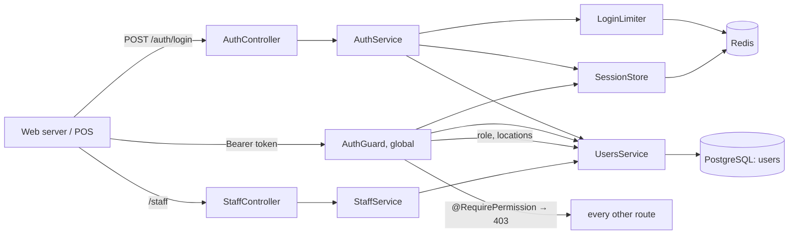

# Identity

Who is signed in and what they may do. Staff users (owner, admins, florists, couriers), their passwords and sessions, roles and permissions, the locations florists and couriers are bound to, and the guard that protects every API route. Customer accounts come later (IAM-03).

Roadmap: IAM-01 ([#31](https://github.com/DevAgassi/flower-network/issues/31)), IAM-02 ([#32](https://github.com/DevAgassi/flower-network/issues/32)), IAM-03 in [ROADMAP.md](../../../ROADMAP.md) · Spec: [init.md §4.8](../../../init.md)

## Pieces

| Piece                                      | Code                                                                                                                                                     | Reference                                             |
| ------------------------------------------ | -------------------------------------------------------------------------------------------------------------------------------------------------------- | ----------------------------------------------------- |
| `users` table                              | [`identity.schema.ts`](../../../apps/api/src/identity/identity.schema.ts)                                                                                | [Sign-in and sessions](sessions.md#users)             |
| Passwords                                  | [`password.ts`](../../../apps/api/src/identity/password.ts)                                                                                              | [Sign-in and sessions](sessions.md#passwords)         |
| Sessions                                   | [`session.store.ts`](../../../apps/api/src/identity/session.store.ts)                                                                                    | [Sign-in and sessions](sessions.md#sessions)          |
| Login limits                               | [`login-limiter.ts`](../../../apps/api/src/identity/login-limiter.ts)                                                                                    | [Sign-in and sessions](sessions.md#login-limits)      |
| Guard, `@Public()`, `@CurrentUser()`       | [`auth.guard.ts`](../../../apps/api/src/identity/auth.guard.ts), [`auth.decorators.ts`](../../../apps/api/src/identity/auth.decorators.ts)               | [Sign-in and sessions](sessions.md#protecting-routes) |
| `/auth/*` endpoints                        | [`auth.controller.ts`](../../../apps/api/src/identity/auth.controller.ts), [`identity.contract.ts`](../../../apps/api/src/identity/identity.contract.ts) | [Sign-in and sessions](sessions.md#api)               |
| Roles, permissions, `@RequirePermission()` | [`permissions.ts`](../../../apps/api/src/identity/permissions.ts), [`auth.decorators.ts`](../../../apps/api/src/identity/auth.decorators.ts)             | [Roles](roles.md#permission-matrix)                   |
| Location scope, `staff_locations`          | [`location-scope.ts`](../../../apps/api/src/identity/location-scope.ts)                                                                                  | [Roles](roles.md#location-scope)                      |
| `/staff` endpoints                         | [`staff.controller.ts`](../../../apps/api/src/identity/staff.controller.ts), [`staff.service.ts`](../../../apps/api/src/identity/staff.service.ts)       | [Roles](roles.md#staff-api)                           |
| `user:create` CLI                          | [`create-user.ts`](../../../apps/api/src/identity/create-user.ts)                                                                                        | [Sign-in and sessions](sessions.md#creating-users)    |

## How it fits together

- Data: the `users` and `staff_locations` tables (PostgreSQL) and session / limiter keys (Redis). Only this module reads or writes them; other modules get the user, role and locations from `@CurrentUser()` and check locations with `assertLocationAccess()`.
- Events: none yet.

## Guides

None yet — the login screen and staff management screens arrive with ADM-01.

## Journal

Problems and their solutions: [journal.md](journal.md).
