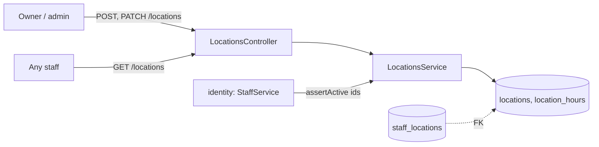

# Locations

The directory of the network's physical places: **stores** (sell at the counter, hand out pickups) and central **warehouses** (receive goods, send transfers), with addresses, coordinates and weekly opening hours. Everything that happens somewhere — stock, staff, cash shifts, shipments — points at a location.

Roadmap: LOC-01 ([#33](https://github.com/DevAgassi/flower-network/issues/33)) in [ROADMAP.md](../../../ROADMAP.md) · Spec: [init.md §4.3](../../../init.md)

## Pieces

| Piece                                | Code                                                                                                                                                                   | Reference                                   |
| ------------------------------------ | ---------------------------------------------------------------------------------------------------------------------------------------------------------------------- | ------------------------------------------- |
| `locations`, `location_hours`        | [`locations.schema.ts`](../../../apps/api/src/locations/locations.schema.ts)                                                                                           | [Locations](locations.md#data)              |
| `/locations` endpoints               | [`locations.controller.ts`](../../../apps/api/src/locations/locations.controller.ts), [`locations.contract.ts`](../../../apps/api/src/locations/locations.contract.ts) | [Locations](locations.md#api)               |
| `LocationsService` for other modules | [`locations.service.ts`](../../../apps/api/src/locations/locations.service.ts)                                                                                         | [Locations](locations.md#for-other-modules) |

## How it fits together

- Data: `locations` and `location_hours`. Only this module reads or writes them; other modules call `LocationsService`. Tables of other modules may reference `locations.id` with a foreign key (`staff_locations` does).
- Events: none yet.

## Guides

None yet — location screens arrive with the admin (ADM-01 and later).

## Journal

Problems and their solutions: [journal.md](journal.md).
