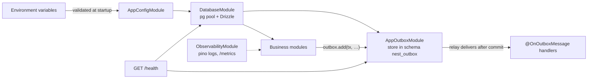

# Platform

The technical foundation every business module stands on: repository and build, configuration, database access, events between modules and local infrastructure. It holds no business logic.

Roadmap: PLT-01…PLT-12 in [ROADMAP.md](../../../ROADMAP.md) · Spec: [init.md §2–3](../../../init.md)

## Pieces

| Piece                 | Code                                                                                                                                | Reference                                        |
| --------------------- | ----------------------------------------------------------------------------------------------------------------------------------- | ------------------------------------------------ |
| Monorepo and build    | [`package.json`](../../../package.json), [`turbo.json`](../../../turbo.json), [`pnpm-workspace.yaml`](../../../pnpm-workspace.yaml) | [Monorepo](monorepo.md)                          |
| Configuration         | [`apps/api/src/config/`](../../../apps/api/src/config/), [`apps/web/src/env.server.ts`](../../../apps/web/src/env.server.ts)        | [Configuration](configuration.md)                |
| Database              | [`apps/api/src/database/`](../../../apps/api/src/database/), [`apps/api/drizzle/`](../../../apps/api/drizzle/)                      | [Database](database.md)                          |
| Outbox                | [`apps/api/src/outbox/`](../../../apps/api/src/outbox/)                                                                             | [Outbox](outbox.md)                              |
| Logs, traces, metrics | [`apps/api/src/observability/`](../../../apps/api/src/observability/)                                                               | [Observability](observability.md)                |
| Local infrastructure  | [`compose.yaml`](../../../compose.yaml), [`infra/`](../../../infra/)                                                                | [Local infrastructure](local-infrastructure.md)  |
| Health check          | [`apps/api/src/health/`](../../../apps/api/src/health/)                                                                             | [API and worker](../../apps/api.md#health-check) |

## How it fits together

1. `AppConfigModule` validates the environment with zod; the process does not start with an invalid one.
2. `DatabaseModule` opens one pool and exposes the Drizzle instance as `DATABASE`.
3. Business modules change data in a transaction and add events to the outbox in the same transaction.
4. The relay (in the API in development, in the worker in production) delivers events to handlers after commit.
5. Tracing starts in the entry point before the app is imported; `ObservabilityModule` provides pino logging and `/metrics`.

## Journal

Problems and their solutions: [journal.md](journal.md).
