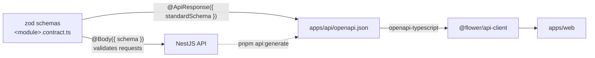

# API contract (OpenAPI and typed client)

Every HTTP endpoint is described by zod schemas. They validate what the API receives, generate the OpenAPI document and, through it, the typed client the web app uses. A change to an endpoint's shape breaks the web's type check instead of failing in production.

Code: [`apps/api/src/openapi/`](../../../apps/api/src/openapi/) · Document: [`apps/api/openapi.json`](../../../apps/api/openapi.json) · Client: [`packages/api-client/`](../../../packages/api-client/) · Issue: [#28](https://github.com/DevAgassi/flower-network/issues/28)



## Adding an endpoint

1. **Schemas** in `apps/api/src/<module>/<module>.contract.ts`. Give every schema that appears in a response or body an `id` — it becomes its name in `components.schemas` and in the client:

   ```ts
   export const createOrderSchema = z
     .object({ variantId: z.uuid(), quantity: z.number().int().positive() })
     .meta({ id: 'CreateOrderRequest' });

   export const orderSchema = z
     .object({
       id: z.uuid(),
       number: z.string(),
       state: z.enum(['pending', 'paid']),
     })
     .meta({ id: 'Order' });
   ```

2. **Controller** — the same schemas validate and document:

   ```ts
   @ApiTags('orders')
   @Controller('orders')
   export class OrdersController {
     @Post()
     @ApiOperation({ summary: 'Create an order' })
     @ApiResponse({ status: HttpStatus.CREATED, standardSchema: orderSchema })
     create(@Body({ schema: createOrderSchema }) body: z.infer<typeof createOrderSchema>) { … }
   }
   ```

   `@Param({ schema })` and `@Query({ schema })` work the same way. Invalid input never reaches the handler: the global `StandardSchemaValidationPipe` (registered in `AppModule`) answers `400` with every problem:

   ```json
   {
     "statusCode": 400,
     "message": [
       "name: Too small: expected string to have >=1 characters",
       "quantity: Invalid input: expected int, received number"
     ],
     "error": "Bad Request"
   }
   ```

3. **Regenerate** and commit the result together with the code:

   ```bash
   pnpm api:generate   # apps/api/openapi.json + packages/api-client/src/schema.ts
   ```

4. **Use it in the web** (server functions):

   ```ts
   import { createApiClient, type ApiSchemas } from '@flower/api-client';

   const api = createApiClient(getServerEnv().API_URL);
   const { data, error } = await api.POST('/orders', {
     body: { variantId, quantity: 2 },
   });
   // data: ApiSchemas['Order'] on 2xx; error: typed body of a documented error status
   ```

## How it works

- **Standard Schema.** zod 4 implements the [Standard Schema](https://standardschema.dev) interface, including JSON Schema output. NestJS 12 validates with it (`@Body({ schema })` + `StandardSchemaValidationPipe`) and `@nestjs/swagger` 12 converts it to OpenAPI (`standardSchema` in `@ApiResponse`). No `class-validator` DTO classes.
- **Generation without a server.** [`generate.ts`](../../../apps/api/src/openapi/generate.ts) creates the app in Nest's _preview_ mode: the module graph is built, providers are not instantiated, so no database or Redis is needed. It prints a "PREVIEW mode" warning — expected.
- **Committed output.** `openapi.json` and `schema.ts` are in git, so pull requests show contract changes. They are excluded from Prettier. A unit test ([`openapi.spec.ts`](../../../apps/api/src/openapi/openapi.spec.ts)) fails when `openapi.json` is out of date with the code.
- **Client.** `openapi-typescript` turns the document into types only (`paths`, `components`); `openapi-fetch` is the small runtime that uses them. A non-2xx response is returned as `error` (typed when the status is documented), not thrown; network failures throw.
- **Operation ids** are `<Controller>_<method>` (`Health_check`).
- **Docs UI.** Outside production the API serves Swagger UI at http://localhost:3001/docs and the JSON at `/docs/openapi.json`. `/metrics` is excluded from the contract.

## Query parameters

- **`@ApiQuery` for every query parameter.** `@nestjs/swagger` turns a `@Query('name', { schema })` into a parameter but always marks it required, and does not expand a whole-object `@Query({ schema })` at all. Validate with the zod schema and document each parameter with `@ApiQuery({ name, required: false, … })` next to it ([locations journal](../locations/journal.md)). Check `required` in the `openapi.json` diff.
- Query values arrive as strings: use `z.coerce.number()` for numbers and `z.enum(['true', 'false'])` for flags.

## Pagination

Every list that can grow large uses **cursor pagination** ([`pagination.contract.ts`](../../../apps/api/src/openapi/pagination.contract.ts)):

```text
GET /products?limit=50               → { items: [...50], nextCursor: "0193…" }
GET /products?limit=50&cursor=0193…  → { items: [...], nextCursor: null }   // last page
```

- Newest first by UUIDv7 `id`; the next page is `id < cursor`. No `OFFSET` scans and no `COUNT(*)` on live tables (init.md §5), and pages stay correct while rows are inserted.
- In a module: spread `paginationQuery` into the query schema, fetch `limit + 1` rows ordered by `id desc`, return `toPage(rows, limit)`; the response schema is `pageSchema(itemSchema, 'ThingPage')`.
- Short directories that never grow large (locations) return a plain array.

## Authentication in the contract

Every route requires a session unless marked `@Public()` ([Sign-in and sessions](../identity/sessions.md#protecting-routes)). Protected operations carry `@ApiBearerAuth()`, so `openapi.json` shows the bearer requirement and the client passes the token. Errors use the shared `ApiError` schema ([`errors.contract.ts`](../../../apps/api/src/openapi/errors.contract.ts)): `@ApiResponse({ status: HttpStatus.UNAUTHORIZED, standardSchema: apiErrorSchema })`.

## Rules

- Every endpoint has zod schemas for its body / params / query and its responses; no untyped `@Body() body: any`.
- Schemas live in the module that owns the endpoint (`<module>.contract.ts`); other apps use `@flower/api-client`, never API source files.
- Run `pnpm api:generate` after changing a controller or contract and commit both generated files.
- Response schemas describe what the API returns; the type of the handler's return value must match them (TypeScript checks it through `z.infer`).

## Commands

| Command                                     | What it does                                      |
| ------------------------------------------- | ------------------------------------------------- |
| `pnpm api:generate`                         | Regenerates `openapi.json` and the client types   |
| `pnpm --filter @flower/api openapi`         | Only `openapi.json`                               |
| `pnpm --filter @flower/api-client generate` | Only the client types, from the existing document |
