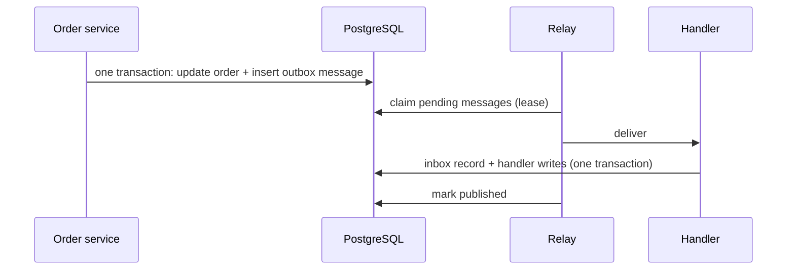

# Events between modules (transactional outbox)

Modules never call each other to react to a change; they publish an event through the transactional outbox ([`@nestjs/outbox`](https://docs.nestjs.com/reliability/outbox), ADR-12 in [init.md](../../../init.md)). The event is saved **in the same transaction** as the business change, so it is delivered if and only if the change committed — even if the process crashes right after the commit.

Code: [`apps/api/src/outbox/`](../../../apps/api/src/outbox/) · Tests: [`apps/api/test/outbox.e2e-spec.ts`](../../../apps/api/test/outbox.e2e-spec.ts) · Issue: [#26](https://github.com/DevAgassi/flower-network/issues/26)

## Why

Without an outbox an event is sent after the commit, as a second step. If the process dies between the two steps, the order is completed but analytics, notifications and fiscal never hear about it. Sending before the commit is worse: the event goes out, then the transaction rolls back.



## How to use it

Produce an event — always inside the transaction of the change:

```ts
import { DATABASE, type Database } from '../database/database.module.js';
import type { AppOutbox } from '../outbox/outbox.module.js';

constructor(@Inject(DATABASE) private readonly db: Database, private readonly outbox: AppOutbox) {}

await this.db.transaction(async (tx) => {
  await tx.update(orders).set({ state: 'completed' }).where(eq(orders.id, id));
  await this.outbox.add(tx, { topic: 'order.completed', key: id, payload: { orderId: id } });
});
this.outbox.notify(); // optional: publish now instead of at the next poll (1 s)
```

Handle it — in any module, as a provider method:

```ts
@OnOutboxMessage('order.completed', { consumer: 'analytics-revenue' }) // stable consumer name
async addRevenue(payload: { orderId: string }, ctx: OutboxHandlerContext<Transaction>) {
  await this.db.transaction((tx) =>
    // inbox record and the write commit together: processed exactly once
    ctx.processInTransaction(tx, async () => { /* update rollup table through tx */ }),
  );
}
```

## Guarantees

| Situation                                                   | Result                                                                           |
| ----------------------------------------------------------- | -------------------------------------------------------------------------------- |
| Transaction rolls back                                      | The message never existed; nothing is delivered                                  |
| `add()` called without a transaction                        | Throws `OutboxTransactionRequiredError`                                          |
| Relay crashes after claiming                                | Another relay takes the message when the 30 s lease expires                      |
| Relay crashes after delivering, before marking it published | Delivered again → the consumer's inbox sees the duplicate and skips it           |
| Handler throws                                              | Retried with growing delays, then moved to `dead_letters` with its error history |
| Handler throws `NonRetryableMessageError`                   | Dead-lettered at once                                                            |
| Same `key`                                                  | Delivered in commit order (e.g. all events of one order)                         |

## How it is wired

- `AppOutboxModule.register()` configures `OutboxModule` with a `PostgresOutboxStore` that writes through Drizzle (`fromDrizzle(db)`), in the PostgreSQL schema `nest_outbox` (`messages`, `inbox`, `dead_letters`).
- Relay settings: poll every 1 s, lease 30 s, publish timeout 10 s. `OUTBOX_RELAY` turns the relay on or off in a process.
- Outside production the store creates its schema at startup; in production `pnpm db:migrate` applies it ([`migrate-outbox.ts`](../../../apps/api/src/migrate-outbox.ts)) and the app refuses to start while it is behind.
- `OutboxRetention` deletes inbox records older than 30 days every day at 03:00 (the package never deletes them itself). It runs only where the relay runs.
- `GET /health` reports `outbox: down` when the outbox tables cannot be read.

## Processes

In development the API also runs the relay — nothing extra to start. In production API instances run with `OUTBOX_RELAY=off` and one or more workers publish. See [API and worker](../../apps/api.md).

## Rules

- Events only through the outbox: never `EventEmitter` or a direct call into another module to react to a change.
- `add()` only inside the transaction of the change it describes.
- `consumer` names are permanent: the inbox is keyed by them; renaming one makes every past message look new to it.
- Handlers are idempotent; their database writes go through `ctx.processInTransaction(tx, …)`.
- Payloads carry ids and the facts consumers need, not whole entities.

## Testing

E2E tests run against the real PostgreSQL in a throwaway schema per test, with the relay's poll loop off; a test drives delivery with `relay.runOnce()`. The package's own contract suites (`outboxStoreContract`, `outboxInboxStoreContract`) run against our store with concurrent relays.
