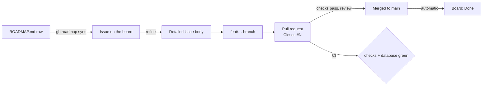

# Development workflow

From a line in the roadmap to merged code.



## 1. Plan: ROADMAP.md and the board

The plan lives in [ROADMAP.md](../../ROADMAP.md); the [Project board](https://github.com/users/DevAgassi/projects/1) is generated from it by the [`gh roadmap`](https://github.com/DevAgassi/gh-roadmap) CLI extension, configured in [roadmap.config.json](../../roadmap.config.json).

One-time setup:

```bash
gh auth refresh -s project
gh extension install DevAgassi/gh-roadmap
```

After changing ROADMAP.md (new feature, new title, new dependency):

```bash
gh roadmap sync --dry-run   # validate
gh roadmap sync             # create/update issues, sub-issues, dependencies and board cards
```

- Feature IDs are permanent; dropped features are marked `dropped`, never deleted or renumbered.
- Statuses set on the board are never overwritten by the sync; new issues start in **Backlog**.
- Board columns are described in [ROADMAP.md → Board workflow](../../ROADMAP.md#board-workflow). Columns are moved by hand; only **Done** is automatic (PR with `Closes #N` merged).

## 2. Refine the issue before starting

A generated issue contains only a header with links. Before work starts, its body is rewritten so it can be understood without reading `init.md` ([#26](https://github.com/DevAgassi/flower-network/issues/26) is the reference):

1. **Why we need it** — with a concrete failure example.
2. **How it works** — diagram where useful.
3. **Decision** — what we chose and why.
4. **What will be done** — task checklist.
5. **Out of scope.**
6. **Acceptance criteria** — checkable.
7. **Glossary** of new terms, **References.**

Keep the generated header line (feature, module, stage, epic, dependencies). Only the issue being started is refined, not all of them at once.

## 3. Branch, commit, pull request

- Branch from `main`: `feat/<feature-id>-<slug>`, e.g. `feat/plt-04-outbox`; `chore/<slug>` for work without a feature.
- Commit subject starts with the feature ID: `PLT-04: transactional outbox with @nestjs/outbox, worker process, inbox`.
- One pull request per feature. Its description closes the issue (`Closes #26`) and lists what was verified.
- The same pull request updates the feature's status to `done` in ROADMAP.md and the documentation ([docs/README.md → When to write what](../README.md#when-to-write-what)).

## 4. Checks

CI runs every check on each pull request; both jobs must be green before merging ([CI](ci.md)). Run them locally before pushing to avoid a red round trip:

```bash
pnpm format:check && pnpm lint && pnpm typecheck && pnpm test && pnpm build && pnpm docs:check
pnpm --filter @flower/api test:e2e   # needs pnpm infra:up
```

After changing a controller, contract or `*.schema.ts`: `pnpm api:generate` / `pnpm --filter @flower/api db:generate` and commit the generated files.

## 5. Merge

- Merge commits (no squash), so feature commits stay visible in history.
- Merging is possible only when CI is green (branch rule on `main`).
- **Stacked pull requests** (B based on A's branch): merge them one at a time. Before A's branch is deleted, retarget B to `main` — deleting a base branch closes every PR based on it. Never merge a stack with an automated loop (see the [journal](journal.md)).
- After merging, delete the branch and pull `main`.
